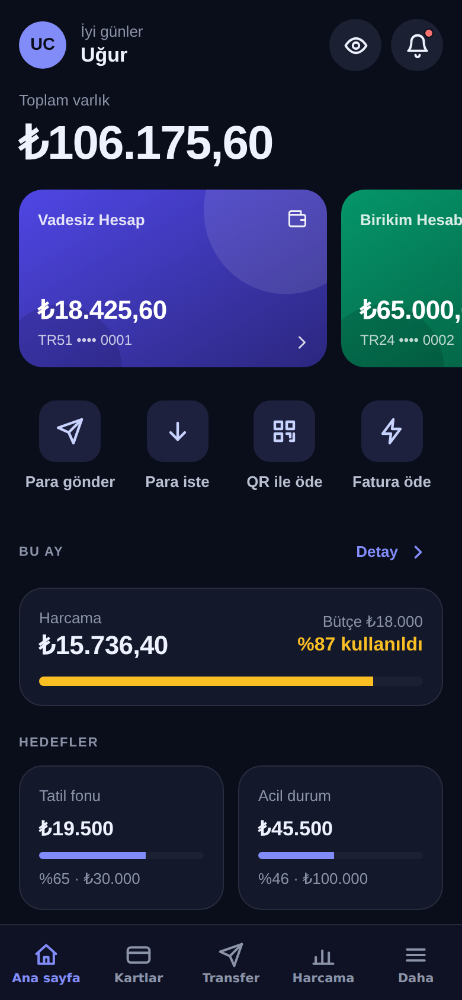

# Bankam — Mobil Bankacılık Uygulaması ve Tasarım Sistemi

Kurgusal bir dijital bankanın mobil uygulaması; **"para transferi 3 dokunuşta"** hedefiyle tasarlanmış, kod olarak yaşayan bir **tasarım sistemi** üzerine kurulu. **React Native + Expo**; iOS, Android ve web'de çalışır. Gerçek para hareketi yoktur.



## Tasarım sistemi

Tasarım sistemi Figma dosyası değil, `src/theme/tokens.ts` içindeki **tek doğruluk kaynağı**dır:

- **Belirteçler** — ilkel renk skalaları (indigo, slate, green, red, amber, sky), açık/koyu tema için 30 anlamsal renk rolü, 4 pt boşluk ızgarası, köşe yarıçapı, 9 kademeli tipografi ölçeği, hareket süreleri, 44 pt minimum dokunma hedefi.
- **Kontrast sözleşmesi** — 16 metin/zemin çifti için minimum WCAG 2.2 oranı (AAA 7:1, AA 4.5:1, arayüz bileşeni 3:1). Aynı sözleşme **iki temada birim testleriyle** doğrulanır (`src/lib/tokens.test.ts`) ve uygulama içindeki *Belirteçler* sayfasında **canlı hesaplanır**. Sözleşmeyi bozan bir renk değişikliği testleri kırar.
- **DTCG dışa aktarım** — `npm run tokens` belirteçleri [W3C Design Tokens](https://tr.designtokens.org/format/) JSON'u ve CSS değişkenleri olarak `design-tokens/` altına yazar; web ekipleri ve tasarım araçları aynı kaynağı kullanır.
- **Bileşen kütüphanesi** (`src/components/ui.tsx`) — Button (4 varyant × 3 boyut, yükleniyor/devre dışı), IconButton, ActionTile, Chip, Segmented, Toggle, Input (odak halkası, hata/yardım), Keypad, ListItem, Avatar, Badge, Banner, Progress, Skeleton, Spinner, Sheet, Toast, Card, Section; alan bileşenleri: AccountCard, BankCard, TxRow, Donut, Bars. Hiçbir bileşende sabit renk yok; hepsi `useTheme()` ile tema ve **yazı ölçeğine** (normal / büyük / çok büyük, WCAG 1.4.4) tepki verir.
- **Canlı galeri** — Daha → Tasarım sistemi → *Bileşenler*: tüm bileşenler seçili tema ve yazı ölçeğiyle ekranda.
- **Erişilebilirlik** — her etkileşimli öğede rol + etiket (`accessibilityRole`, `accessibilityLabel`, `accessibilityState`), progressbar/switch/radio semantiği, bakiye gizlemede ekran okuyucu etiketi, hatalar `role=alert`. Uçtan uca test bütün düğme/anahtarların erişilebilir adını ve dokunma hedefi boyutunu denetler.

## Uygulama

- **Giriş** — PIN tuş takımı (demo: 4 haneli herhangi bir PIN), Face ID düğmesi; yenilemede oturum kilitlenir.
- **Ana sayfa** — toplam varlık, 3 hesap kartı (gradyan, maskeli IBAN), hızlı işlemler, aylık bütçe durumu, birikim hedefleri, güne göre gruplanmış son işlemler, tek dokunuşla bakiye gizleme.
- **Transfer (3 dokunuş)** — favori/son alıcı → hızlı tutar → onay. Transfer kuralları saf fonksiyonlarda (`src/lib/bank.ts`): aynı banka → Havale, ₺5.000 altı → FAST ücretsiz, üstü mesai içinde EFT / dışında FAST + ₺3,50, hesaplar arası ücretsiz, tek seferlik ₺25.000 ve günlük ₺50.000 limiti, yetersiz bakiye, yüksek tutar uyarısı. Ücret ayrı işlem kaydı olarak düşer.
- **Yeni alıcı** — IBAN mod-97 (ISO 13616) doğrulaması yazarken, banka kodu tanıma.
- **Kartlar** — banka ve kredi kartı görselleri; dondur / internet alışverişi / temassız anahtarları, alt sayfadan harcama limiti, kredi kartında dönem borcu ve asgari ödeme.
- **Harcamalar** — kategori halka grafiği, kategori bütçeleri (%80 uyarı, %100 aşıldı), 6 aylık gelir/gider çubukları, hedef için gereken aylık birikim.
- **Hesap / işlem detayı** — tam IBAN, arama + kategori filtresi, işlem detayında kanal/banka bilgisi, "tekrar gönder".
- **Ayarlar** — tema (açık / koyu / sistem), yazı boyutu, gizlilik anahtarları, oturum kilidi, demo sıfırlama.

## Teknolojiler

React Native 0.86, Expo SDK 57, Expo Router, TypeScript (strict), react-native-svg, expo-haptics, Zustand + AsyncStorage, Vitest, Playwright.

## Çalıştırma

```bash
npm install
npx expo start      # Expo Go ile QR okut
npm run web
npm run tokens      # design-tokens/tokens.json + tokens.css
```

## Test

```bash
npm test            # 54 birim testi: kontrast sözleşmesi (2 tema × 16 çift), tipografi/boşluk kuralları, para/IBAN/Luhn, transfer kuralları, analiz
npm run export:web && npm run serve 8081 &
npm run e2e         # 41 kontrollü uçtan uca akış + 21 gerçek ekran görüntüsü (koyu ve açık tema, büyük yazı)
```

## Lisans

MIT — Uğur Can Elsun
